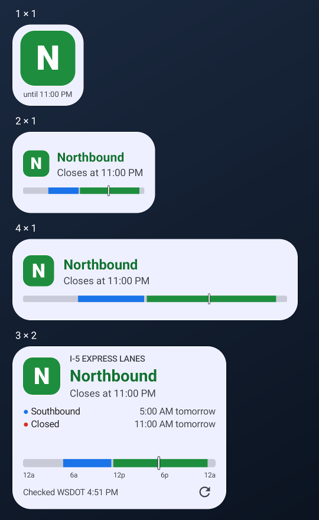
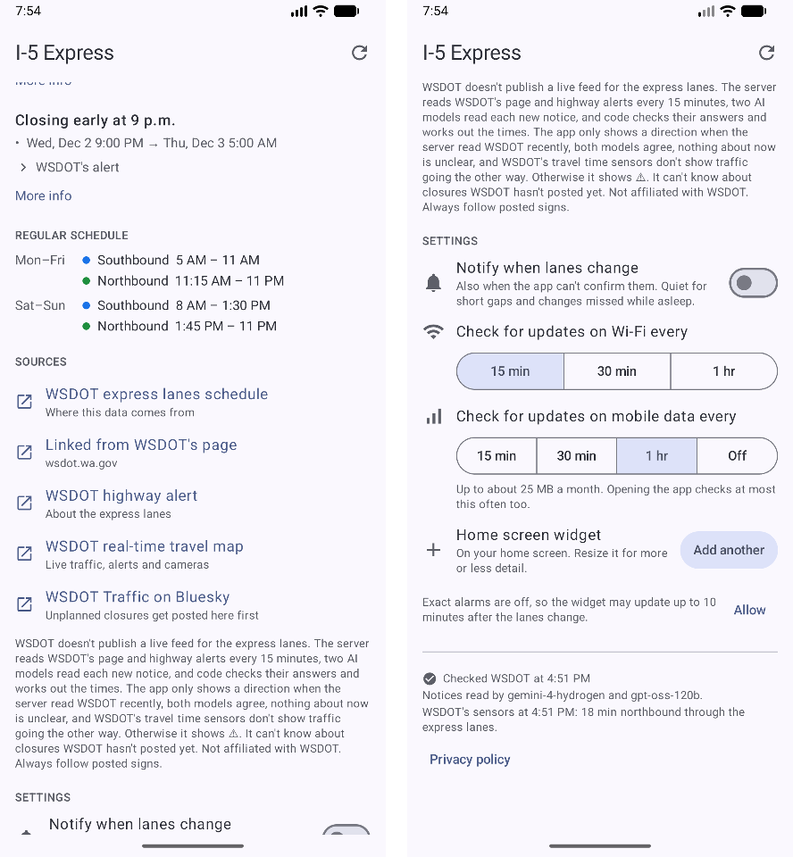

# I-5 Express for Android

A home screen widget that shows which way Seattle's I-5 express lanes are running right now, and whether they're open at all. Tap it for the details.


It's the Android version of [i5-macos-menubar](https://github.com/andrewmacheret/i5-macos-menubar), and uses the same rules.

## Features

### Widget

- A colored badge shows the current state: green **N** for northbound, blue **S** for southbound, red **✕** for closed.
- Under it: when the lanes change next, the next couple of changes after that, and a timeline of today with a marker for now.
- An amber **⚠ Can't confirm** replaces the badge whenever the app can't vouch for the status, with the reason. It still shows the posted schedule, labeled "not confirmed". See [When to trust it](#when-to-trust-it).
- A gray **? Checking…** shows briefly while the app re-reads WSDOT's page.
- The refresh button in the corner re-reads WSDOT's page. Tapping anywhere else opens the app.
- The widget updates itself at the exact minute the lanes change, at midnight, and when its data gets too old to trust. It doesn't wait for the next 15-minute check.


Other reasons it won't confirm include a WSDOT notice about today and a saved copy of the page that's more than 2 hours old:


### Widget sizes

The widget is resizable. Smaller sizes drop detail but keep the badge and the next change:

- **1 × 1:** the badge and "until 9:00 PM".
- **2 × 1 and wider:** the badge, direction, next change and today's timeline.
- **3 × 2 and bigger (the default):** everything above, plus the next changes, hour labels, when WSDOT was last read, and the refresh button.



### App

Tap the widget, or open **I-5 Express** from the app drawer:

- **Status:** the current direction and what happens next, like "Closes at 9:00 PM · in 4h 5m".
- **Warnings:** each reason the status can't be confirmed, with links to live sources (traffic cameras, [@wsdot_traffic](https://x.com/wsdot_traffic) and WSDOT's page) so you can check before you drive.
- **Notices:** closures in effect now, tonight's early closure, and WSDOT notices. Old notices that WSDOT hasn't taken down yet are grayed out.
- **Schedule:** colored timelines for today and tomorrow, with a marker for now.
- **Coming up:** the next four changes with countdowns. A ⚠ marks days that may not follow the regular schedule.
- **Planned changes:** weekend closures, early closing dates, and holidays in the next two weeks.
- **Regular schedule and sources:** the weekly schedule as WSDOT posts it, and links to every page the data comes from.
- Pull down, or tap the refresh button, to re-read WSDOT's page. It also refreshes when you open the app.

Times are always Seattle time. If your phone is set to another time zone, the app and widget say so.

<p>
  
</p>
<p>
  
</p>

### Notifications

Turn on **Notify when lanes change** in the app's settings to get:

- an alert when the lanes switch direction, open or close;
- an alert when the app goes from confirmed to "can't confirm", with the reason.

To keep alerts useful, the app:

- skips the 15-minute weekday switchover gap;
- skips any change it missed while the phone was off or asleep for a long time;
- doesn't alert when the only problem is old data, since that usually fixes itself on the next refresh (for example right after the phone starts up, or overnight when Android pauses the network);
- holds a "can't confirm" alert until the lanes are scheduled to open, so a holiday doesn't buzz you at midnight.

It asks for notification permission when you turn this on, and shows a link to Android's settings if notifications are blocked.


### Settings

- **Notify when lanes change**, described above.
- **Home screen widget:** an **Add** button that puts the widget on your home screen, on launchers that support it.
- If Android turned off exact alarms for the app, a note explains that the widget may update a few minutes late, with a button to allow them.

## When to trust it

WSDOT doesn't publish a live feed for the express lanes. This app reads [WSDOT's express lanes page](https://wsdot.wa.gov/travel/roads-bridges/express-lanes) and works out the status from the posted schedule, early closures and planned closures.

It only shows **N**, **S** or **✕** when all of these are true:

- It read WSDOT's page in the last 2 hours. It checks every 15 minutes or so, when you open the app, and after the phone restarts.
- Every part of the page made sense. A new section or a line it can't read counts as a problem.
- The schedule itself looks sane, with no overlapping or backwards time ranges.
- Nothing on the page suggests today is different. That includes notices dated today, undated notices, and planned closures today without exact times.
- If today closes early, the page gives the closing time.
- Today isn't a holiday. WSDOT doesn't post holiday hours.

Otherwise it shows an amber **⚠**, explains why, and links to the [travel map](https://wsdot.com/travel/real-time/map/) and [@wsdot_traffic](https://x.com/wsdot_traffic) so you can check a live source.

If WSDOT can't be reached, the app keeps using the last good copy of the page, and shows ⚠ once that copy is more than 2 hours old. The widget switches to ⚠ at that moment even if the phone is offline.

If WSDOT's page changes into something the app can't read, it shows ⚠ until it reads a good copy again. It remembers this across restarts and failed downloads, so it never quietly goes back to trusting the old copy.

Notices count from their first date until their last. A notice like "As of Nov. 16, the express lanes are closed" has no end date, so it counts for as long as it's on the page.

It can't know about a closure WSDOT hasn't posted yet, like an emergency repair announced only on social media.

## Install

There's no Play Store listing. You build it yourself with [Android Studio](https://developer.android.com/studio), which brings the SDK, a JDK and `adb`. The app needs Android 8.0 or later.

### 1. Get your phone ready

1. Turn on developer options: open **Settings > About phone** and tap **Build number** seven times.
2. Turn on **Settings > System > Developer options > USB debugging**.
3. Plug the phone into your computer and tap **Allow** on the "Allow USB debugging?" prompt.

Check that `adb` sees it. Android Studio puts `adb` in `~/Library/Android/sdk/platform-tools` on a Mac:

```bash
~/Library/Android/sdk/platform-tools/adb devices
```

Your phone should be listed as `device`. If it says `unauthorized`, unlock the phone and accept the prompt.

### 2. Build and install

```bash
git clone https://github.com/andrewmacheret/i5-android.git
cd i5-android
make release
```

That builds the release APK and installs it with `adb`. If more than one device is connected, such as a phone and an emulator, name the one you want with the serial from `adb devices`:

```bash
ANDROID_SERIAL=<serial> make release
```

To run the steps yourself instead of using `make`:

```bash
export JAVA_HOME="/Applications/Android Studio.app/Contents/jbr/Contents/Home"
./gradlew :app:assembleRelease
~/Library/Android/sdk/platform-tools/adb -s <serial> install -r app/build/outputs/apk/release/app-release.apk
```

`-r` keeps the app's data and widgets when you install over an older copy. If Google Play Protect warns about an unknown app, choose to install anyway. It hasn't seen this app before because you built it.

### 3. Add the widget

Long press your home screen, tap **Widgets**, and drag **I-5 Express** onto it. Or open the app and tap **Add** in settings. Turn on **Notify when lanes change** in the app if you want alerts.

The release build is signed with your local debug key, so it's for your own devices only. To remove it, run `adb uninstall com.andrewmacheret.i5`, or uninstall it like any other app.

### Battery and alarms

The app doesn't run in the background. Android wakes it:

- every 15 minutes or so, when there's a network connection, to re-read WSDOT's page;
- with an exact alarm at the next lane change, at midnight, and when the data would go stale, to redraw the widget. The alarm draws the widget itself instead of waiting for a background job, so the widget flips on time even while the phone is idle.

That's a handful of short wake-ups a day. On Android 13 and later the exact alarm permission comes with the app. On Android 12 you can turn it off in settings, and then the widget still updates, just a few minutes late.

## Development

The Makefile uses Android Studio's bundled JDK and the SDK in `~/Library/Android/sdk`, so you don't need a separate Java install. Override `JAVA_HOME`, `SDK` or `AVD` if yours are elsewhere.

| Command | What it does |
| --- | --- |
| `make test` | Run the parser, schedule, trust and alert tests |
| `make build` | Build the debug APK |
| `make install` | Build and install the debug APK |
| `make run` | Install the debug APK and open the app |
| `make release` | Build the shrunk release APK and install it |
| `make emulator` | Start the emulator named by `AVD` |
| `make lint` | Run Android lint |
| `make scenario NAME=holiday` | Show a made-up moment, debug builds only (see below) |
| `make gallery` | Open the widget size gallery, debug builds only |
| `make screenshots` | Regenerate the images in `docs/` |

The code is split into two modules:

- `core` is plain Kotlin with no Android code. It reads WSDOT's page (`Parser`), works out the status at any moment (`Engine`), decides whether the status can be trusted (`Trust`), and decides when to alert (`Alerts`). Tests run against a saved copy of WSDOT's page in `core/src/test/resources`.
- `app` is the Android app: the widget (Jetpack Glance), the app screen (Jetpack Compose), background refresh (WorkManager), exact alarms, and notifications.

### Debug scenarios

Debug builds can show a made-up moment instead of the live status, using a saved copy of WSDOT's page. That's how the screenshots are made, and how you can check every state without waiting for it:

```bash
make scenario NAME=north     # also: south closed weekend closure notice holiday stale checking offline broken
make scenario NAME=live      # back to the real status
```

Debug builds also have test hooks for notifications and for the alarm that fires at each lane change:

```bash
adb shell am broadcast -n com.andrewmacheret.i5/.DebugReceiver --es notify change   # or closed, cantconfirm
adb shell am broadcast -n com.andrewmacheret.i5/.DebugReceiver --ez tick true
```

None of this is in release builds.

## Built with LLM tools

This project was written with LLM coding tools: an AI agent in [Cursor](https://cursor.com) wrote the code, tests and this README, directed by a human. Treat it like any other code from the internet and read it before you rely on it.

## Not affiliated with WSDOT

This is a personal project. Schedule data comes from the Washington State Department of Transportation. Always follow posted signs on the road.

## License

[MIT](LICENSE)
