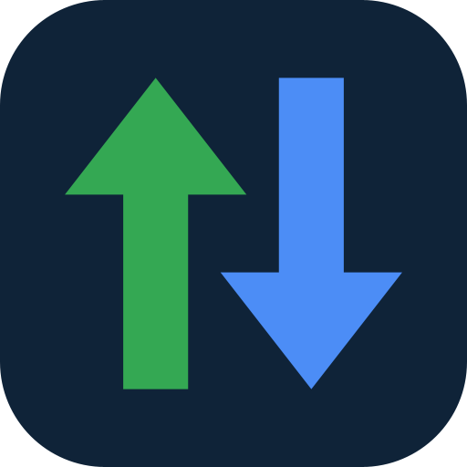
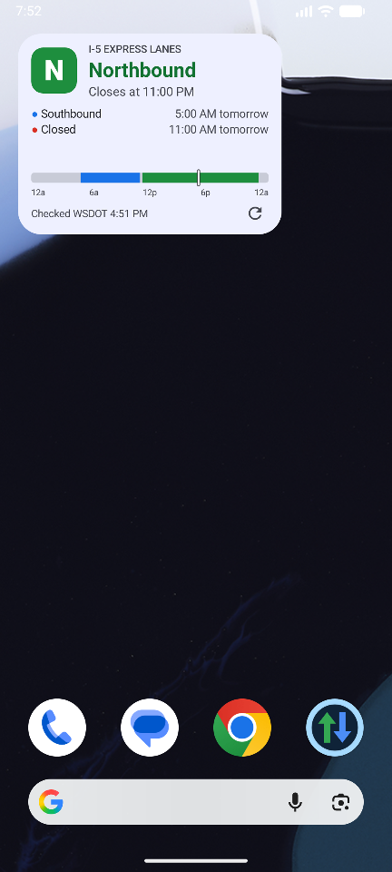
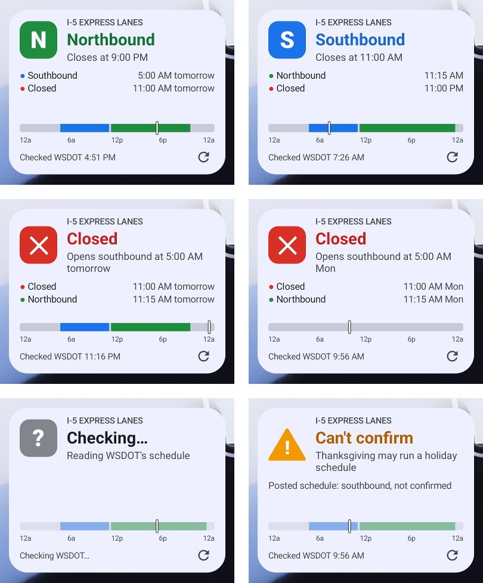
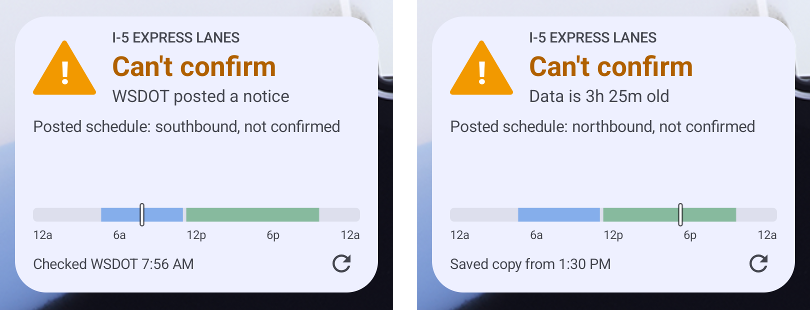
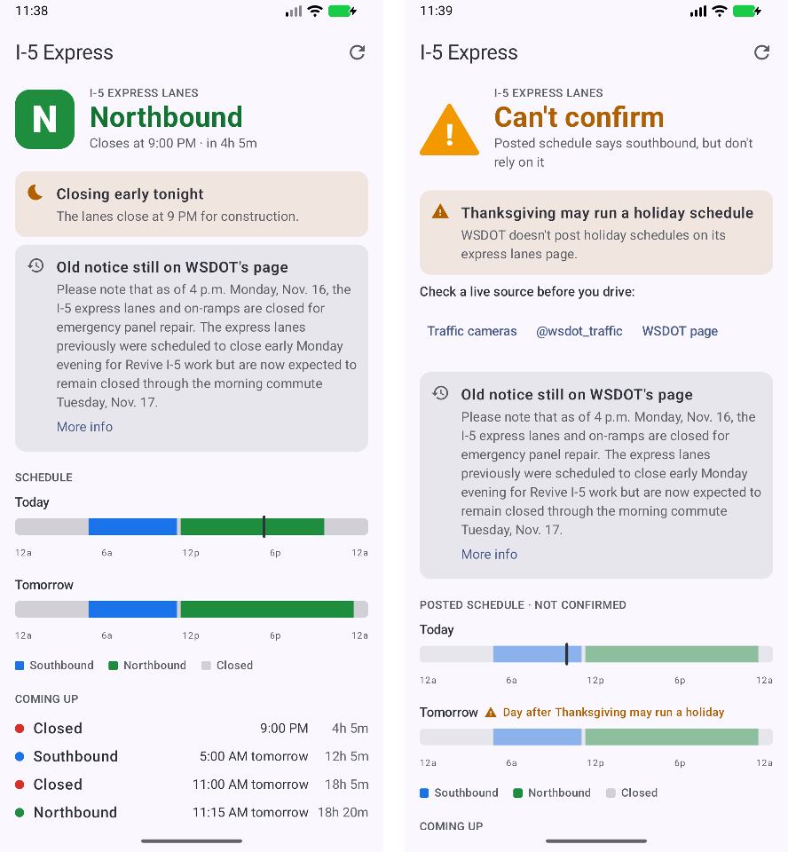
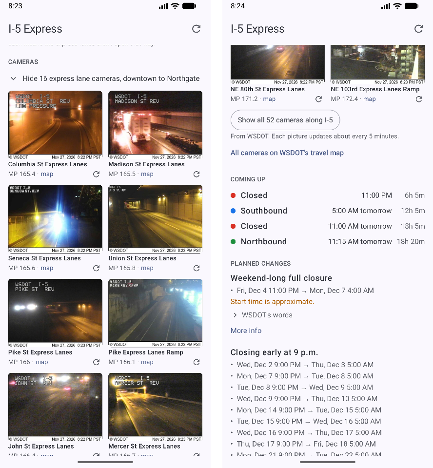
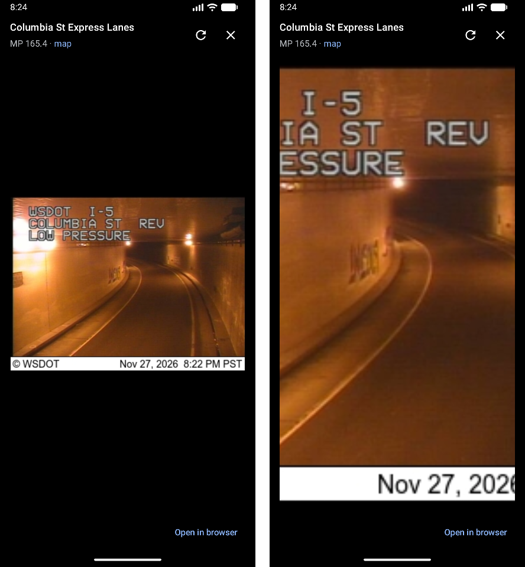
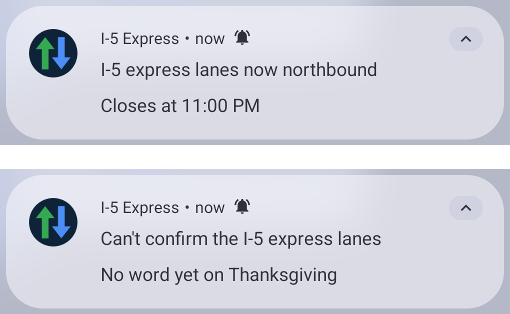

# I-5 Express for Android

[](https://github.com/andrewmacheret/i5-android/actions/workflows/build.yml) [](https://github.com/andrewmacheret/i5-android/actions/workflows/canary.yml) [](https://github.com/andrewmacheret/i5-android/blob/main/LICENSE)

A home screen widget that shows which way Seattle's I-5 express lanes are running right now, and whether they're open at all. Tap it for the details.



The schedule comes from [i5-server-lambdas](https://github.com/andrewmacheret/i5-server-lambdas), a small server that reads WSDOT's express lanes page and highway alerts every 15 minutes and has two AI models read each new notice. It's the Android version of [i5-macos-menubar](https://github.com/andrewmacheret/i5-macos-menubar) and of the web page [i5-client](https://andrewmacheret.com/projects/i5/), and shows the same thing.

## Features

### Widget

- A colored badge shows the current state: green **N** for northbound, blue **S** for southbound, red **✕** for closed.
- Under it: when the lanes change next, the next couple of changes after that, and a timeline of today with a marker for now.
- An amber **⚠ Can't confirm** replaces the badge whenever the app can't vouch for the status, with the reason. It still shows the expected schedule, labeled "not confirmed". See [When to trust it](#when-to-trust-it).
- A gray **? Checking…** shows briefly while the server reads a new update from WSDOT, or while the app asks the server.
- The refresh button in the corner asks the server again. Tapping anywhere else opens the app.
- The widget updates itself at the exact minute the lanes change, at midnight, and when its data gets too old to trust. It doesn't wait for the next scheduled check.



Other reasons it won't confirm include a WSDOT update the server couldn't read, data more than 2 hours old, WSDOT's sensors showing traffic going the other way, and not reaching the server at all:



### Widget sizes

The widget is resizable. Smaller sizes drop detail but keep the badge and the next change:

- **1 × 1:** the badge and "until 9:00 PM".
- **2 × 1 and wider:** the badge, direction, next change and today's timeline.
- **3 × 2 and bigger (the default):** everything above, plus the next changes, hour labels, when the server last read WSDOT, and the refresh button.

Text is never cut off. It's measured at your phone's font size, and when it doesn't fit the widget uses shorter wording: "Closes at 11:00 PM", then "until 11:00 PM", then "11:00 PM", and "North" for "Northbound". A time never splits across two lines. On a very narrow 1 × 1 the widget leaves the time off rather than cut it.


### Dark mode

The app and widget follow the phone's light or dark mode. On Android 12 and later the app also picks up your wallpaper colors.


### App

Tap the widget, or open **I-5 Express** from the app drawer:

- **Status:** the current direction and what happens next, like "Closes at 11:00 PM · 6h 5m".
- **Warnings:** each reason the status can't be confirmed, with links to live sources ([WSDOT Traffic on Bluesky](https://bsky.app/profile/traffic.wsdot.wa.gov), traffic cameras and WSDOT's page) so you can check before you drive.
- **Notices:** WSDOT notices in effect now or later today, like tonight's early closure, each with a **More info** link.
- **Schedule:** colored timelines for today and tomorrow, with a marker for now. Stripes mark times the server's timeline doesn't cover yet.
- **Travel times:** Seattle to Everett and back through the express lanes and the regular lanes, from WSDOT's sensors, with how many minutes the express lanes save and what the regular lanes usually take. It's left out when the reading is more than 30 minutes old.
- **Cameras:** WSDOT's traffic cameras along the express lanes. The section starts closed, and no pictures load until you open it. Express lane cameras come first, and **Show all cameras along I-5** adds the rest. Pictures refresh every 5 minutes while it's open. If a picture doesn't load, the app tries 3 more times, after 5, 15 and 45 seconds, and then shows "Picture didn't load" in its place. The small reload button at the end of each camera's line loads its picture again right away. Tap a picture to see it full screen, where you can pinch or double tap to zoom, drag to look around, reload it, or tap **Open in browser** for WSDOT's file. **map** shows one camera on WSDOT's travel map, and **All cameras on WSDOT's travel map** under the pictures shows them all. The **Traffic cameras** link in the warnings opens this section.
- **Coming up:** the next four changes with countdowns. A ⚠ marks days that may not go as planned.
- **Planned changes:** WSDOT's notices for the next two weeks, like weekend closures and early closing dates, with each time as a bullet. Long lists show 20 times, then **…** for the rest. Each notice says how sure WSDOT is about the times, and has WSDOT's own words and a **More info** link. Holidays with no notice are listed too.
- **Regular schedule and sources:** the weekly schedule as WSDOT posts it, and links to every page the data comes from.
- **Data status:** when the server last read WSDOT, which AI models read the notices, and what WSDOT's sensors measured.
- Pull down, or tap the refresh button, to ask the server again. Its whole answer is about 29 KB, so a refresh usually takes well under a second. It also refreshes when you open the app, within the limits in [Settings](#settings).

Times are always Seattle time. If your phone is set to another time zone, the app and widget say so.

<p>
  
</p>
<p>
  
</p>
<p>
  
</p>
<p>
  
</p>

### Notifications

Turn on **Notify when lanes change** in the app's settings to get:

- an alert when the lanes switch direction, open or close;
- an alert when the app goes from confirmed to "can't confirm", with the reason.

To keep alerts useful, the app:

- skips the 15-minute weekday switchover gap;
- skips any change it missed while the phone was off or asleep for a long time;
- doesn't alert when the only problem is old data, since that usually fixes itself on the next refresh (for example right after the phone starts up, or overnight when Android pauses the network);
- holds a "can't confirm" alert until the lanes are scheduled to open, so a holiday doesn't buzz you at midnight.

It asks for notification permission when you turn this on, and shows a link to Android's settings if notifications are blocked.



### Settings

- **Notify when lanes change**, described above.
- **Check for updates on Wi-Fi every** 15 minutes (the default), 30 minutes or 1 hour.
- **Check for updates on mobile data every** 15 minutes, 30 minutes, 1 hour (the default), or **Off**. Each check uses about 35 KB, so 1 hour is at most about 25 MB a month and 15 minutes about 101 MB. Camera pictures only load while the Cameras section is open, and aren't counted here. On mobile data, opening the app also waits for this setting. With **Off**, the app only uses mobile data when you tap refresh or add a widget. Away from Wi-Fi, the widget then shows ⚠ once the data is 2 hours old, and the app checks again when you're back on Wi-Fi.
- Wi-Fi here means any network Android doesn't treat as metered. A phone hotspot counts as mobile data. Tapping refresh always checks, on any network.
- **Home screen widget:** an **Add** button that puts the widget on your home screen, on launchers that support it.
- If exact alarms are off, a note explains that the widget may update up to 10 minutes late, with an **Allow** button. They start off on Android 14 and later. See [Battery and alarms](#battery-and-alarms).
- At the bottom: a link to the [privacy policy](PRIVACY.md).

## When to trust it

WSDOT doesn't publish a live feed for the express lanes. The [I-5 server](https://github.com/andrewmacheret/i5-server-lambdas) reads [WSDOT's express lanes page](https://wsdot.wa.gov/travel/roads-bridges/express-lanes) and highway alerts, and publishes a timeline of the lanes along with the times it can't vouch for. The app works out the status from that timeline, with the same rules as the web page.

It only shows **N**, **S** or **✕** when all of these are true:

- The server read WSDOT in the last 2 hours. The app asks on a schedule you pick in [Settings](#settings), when you open the app, and after the phone restarts.
- The server has no doubts about right now, like a notice it couldn't pin down, an update it's still reading, or a holiday WSDOT hasn't posted hours for. The server's README lists [every doubt](https://github.com/andrewmacheret/i5-server-lambdas#doubts).
- The phone's clock agrees with the server's.
- WSDOT's travel time sensors don't show traffic going the other way.

Otherwise it shows an amber **⚠**, explains why, and links to [WSDOT Traffic on Bluesky](https://bsky.app/profile/traffic.wsdot.wa.gov), traffic cameras and WSDOT's page so you can check a live source.

If the server can't be reached, the app keeps using the last good copy, and shows ⚠ once that copy is more than 2 hours old. The widget switches to ⚠ at that moment even if the phone is offline.

It can't know about a closure WSDOT hasn't posted yet, like an emergency repair announced only on social media.

## Install

There's no Play Store listing. Download the APK from [Releases](https://github.com/andrewmacheret/i5-android/releases), or build it yourself. The app needs Android 8.0 or later.

### Download the APK

**On the phone:** open the [latest release](https://github.com/andrewmacheret/i5-android/releases/latest) in the phone's browser and tap the `.apk` file. Android asks you to allow installs from your browser the first time. Then tap **Install**.

**From a computer with `adb`:** download the `.apk` from the latest release, get your phone ready (step 1 below), then run:

```bash
adb install -r i5-express-v1.0.0.apk
```

Use the file name of the version you downloaded. Then [add the widget](#3-add-the-widget).

### Build it yourself

You need [Android Studio](https://developer.android.com/studio), which brings the SDK, a JDK and `adb`. Building works on macOS, Linux and Windows. The `make` commands need macOS or Linux. On Windows, use the Gradle steps under [Build and install](#2-build-and-install).

Android Studio puts these in different places on each system:

| | SDK, with `adb` in its `platform-tools` folder | Bundled JDK |
| --- | --- | --- |
| macOS | `~/Library/Android/sdk` | `/Applications/Android Studio.app/Contents/jbr/Contents/Home` |
| Linux | `~/Android/Sdk` | the `jbr` folder where you unpacked Android Studio |
| Windows | `%LOCALAPPDATA%\Android\Sdk` | `C:\Program Files\Android\Android Studio\jbr` |

The commands below say `adb`. Add the SDK's `platform-tools` folder to your PATH, or type the full path.

### 1. Get your phone ready

1. Turn on developer options: open **Settings > About phone** and tap **Build number** seven times.
2. Turn on **Settings > System > Developer options > USB debugging**.
3. Plug the phone into your computer and tap **Allow** on the "Allow USB debugging?" prompt.

Check that `adb` sees it:

```bash
adb devices
```

Your phone should be listed as `device`. If it says `unauthorized`, unlock the phone and accept the prompt.

### 2. Build and install

```bash
git clone https://github.com/andrewmacheret/i5-android.git
cd i5-android
make release
```

That builds the release APK and installs it with `adb`. It finds the SDK and JDK in the places above. If yours are elsewhere, set `ANDROID_HOME` and `JAVA_HOME`. If more than one device is connected, such as a phone and an emulator, name the one you want with the serial from `adb devices`:

```bash
ANDROID_SERIAL=<serial> make release
```

To run the steps yourself instead of using `make`, which you need to do on Windows:

```bash
./gradlew :app:assembleRelease      # on Windows: gradlew.bat :app:assembleRelease
adb -s <serial> install -r app/build/outputs/apk/release/app-release.apk
```

Gradle has to find the SDK and a JDK. If you've opened the project in Android Studio, it already set that up. Otherwise set `ANDROID_HOME` to the SDK folder and `JAVA_HOME` to the bundled JDK from the table above.

`-r` keeps the app's data and widgets when you install over an older copy. If Google Play Protect warns about an unknown app, choose to install anyway. It hasn't seen this app before because you built it.

### 3. Add the widget

Long press your home screen, tap **Widgets**, and drag **I-5 Express** onto it. Or open the app and tap **Add** in settings. Turn on **Notify when lanes change** in the app if you want alerts.

To remove the app, uninstall it like any other app, or run `adb uninstall com.andrewmacheret.i5`.

Android only installs an update over an existing copy if both are signed with the same key. The APKs on the Releases page share one key. A copy you build yourself is signed with your own debug key, so to switch between the two you have to uninstall first, which clears the app's settings.

### Battery and alarms

The app doesn't run in the background. Android wakes it:

- every 15 minutes to 1 hour, depending on your settings and whether you're on Wi-Fi, to ask the server for the latest;
- with an exact alarm at the next lane change, at midnight, when the data would go stale, and when one of the server's doubts starts or ends, to redraw the widget. The alarm draws the widget itself instead of waiting for a background job, so the widget flips on time even while the phone is idle.

That's a handful of short wake-ups a day.

Exact alarms need the **Alarms & reminders** permission. On Android 14 and later it starts off, and you turn it on with **Allow** in the app's settings. Without it the widget still updates, up to 10 minutes after each change while the phone is awake, or when you next wake the phone. The app asks for this permission instead of the automatic one because Google Play only allows that for alarm clock and calendar apps.

## Development

The Makefile works on macOS and Linux. It uses Android Studio's bundled JDK and SDK from [the places above](#build-it-yourself), so you don't need a separate Java install. Set `JAVA_HOME`, `ANDROID_HOME` or `AVD` if yours are elsewhere. On Windows, run the Gradle tasks from the Makefile with `gradlew.bat`.

| Command | What it does |
| --- | --- |
| `make test` | Run the timeline, trust, page text and alert tests |
| `make build` | Build the debug APK |
| `make install` | Build and install the debug APK |
| `make run` | Install the debug APK and open the app |
| `make release` | Build the shrunk release APK and install it, signed with the release key if it's in this Mac's Keychain, or else the debug key |
| `make bundle` | Build the signed app bundle (`.aab`) that Google Play wants |
| `make emulator` | Start the emulator named by `AVD` |
| `make lint` | Run Android lint |
| `make scenario NAME=holiday` | Show a made-up moment, debug builds only (see below) |
| `make gallery` | Open the widget size gallery, debug builds only. `make gallery MORE=1` adds narrow and in-between sizes, for checking that no text gets cut off |
| `make screenshots` | Regenerate the images in `docs/`. `scripts/screenshots.sh cameras` redoes just the Cameras images, and doesn't need the widget on the home screen |

The code is split into two modules:

- `core` is plain Kotlin with no Android code. It downloads and reads the server's `/status` answer (`Fetcher`, `StatusJson`), looks up the status at any moment (`Timeline`), decides whether it can be trusted (`Trust`), words the app screen (`Page`, `Cameras`), and decides when to alert (`Alerts`). It's a port of `src/core` in [i5-server-lambdas](https://github.com/andrewmacheret/i5-server-lambdas), which is the source of truth, so keep them in step. Tests run against saved server answers in `core/src/test/resources/fixtures`, copied from [i5-client](https://github.com/andrewmacheret/i5-client).
- `app` is the Android app: the widget (Jetpack Glance), the app screen (Jetpack Compose), background refresh (WorkManager), exact alarms, and notifications.

### Debug scenarios

Debug builds can show a made-up moment instead of the live status. They use the saved server answers from the tests, with the clock moved. That's how the screenshots are made, and how you can check every state without waiting for it:

```bash
make scenario NAME=north     # also: evening south closed weekend closure notice holiday stale checking failed sensors saved offline loading
make scenario NAME=live      # back to the real status
```

Debug builds also have test hooks for notifications and for the alarm that fires at each lane change:

```bash
adb shell am broadcast -n com.andrewmacheret.i5/.DebugReceiver --es notify change   # or closed, cantconfirm
adb shell am broadcast -n com.andrewmacheret.i5/.DebugReceiver --ez tick true
```

None of this is in release builds.

### Releases

GitHub Actions ([`build.yml`](.github/workflows/build.yml)) runs the tests and a debug build on every push. Pushing a version tag also builds the signed release APK and publishes it on the [Releases](https://github.com/andrewmacheret/i5-android/releases) page. It also saves the signed app bundle for Google Play as a download on that run (**Artifacts**, kept 90 days):

```bash
git tag v1.0.1
git push origin v1.0.1
```

The tag sets the version name. The version code is the number of commits, so every release installs over the last one.

The release key is managed by [`scripts/signing.sh`](scripts/signing.sh). It keeps the key in the macOS Keychain, so it only works on a Mac. You don't need it to build. Without it, builds use the debug key.

| Command | What it does |
| --- | --- |
| `scripts/signing.sh create` | Make the key, once ever, and back up the key file and its password in the macOS Keychain |
| `scripts/signing.sh github` | Copy both into the repo's GitHub Actions secrets, `I5_KEYSTORE_BASE64` and `I5_KEYSTORE_PASSWORD` |
| `scripts/signing.sh restore` | Write the key file back out from the Keychain, to `~/.android/i5-android-release.jks` |
| `scripts/signing.sh run <command>` | Run a build with the key, which is what `make release` does |

The Keychain holds the only copy you can read back, since GitHub secrets are write-only. Don't delete the `i5-android-release-keystore` and `i5-android-release-password` items. Without them, the next release can't update phones that already have the app. The password only travels through environment variables and stdin, never on a command line.

### Google Play

The app isn't on Google Play yet, but it's ready to upload. When you set up Play App Signing, choose to use your existing key and upload this one, rather than letting Google make a new key. Then copies from Google Play and from the Releases page share a signature, and each can update the other. The privacy policy URL for the listing is <https://github.com/andrewmacheret/i5-android/blob/main/PRIVACY.md>.

## Privacy

The app collects nothing. It downloads the schedule from the I-5 server, which keeps no record of requests, and only loads camera pictures from WSDOT when you open the Cameras section. Everything it saves stays on your phone. See the [privacy policy](PRIVACY.md).

## Health check

The Canary workflow (`.github/workflows/canary.yml`) runs `LiveStatusTest` once a day with `I5_LIVE=1`. It reads the I-5 server's real answer with the app's own code, and fails if the app can't read it or the timeline doesn't cover today. Normal test runs skip it. It's started by [andrewmacheret/canary](https://github.com/andrewmacheret/canary).

## Built with LLM tools

This project was written with LLM coding tools: an AI agent in [Cursor](https://cursor.com) wrote the code, tests and this README, directed by a human. Treat it like any other code from the internet and read it before you rely on it.

## Not affiliated with WSDOT

This is a personal project. Schedule data comes from the Washington State Department of Transportation, by way of the I-5 server. Always follow posted signs on the road.

## License

[MIT](LICENSE)
