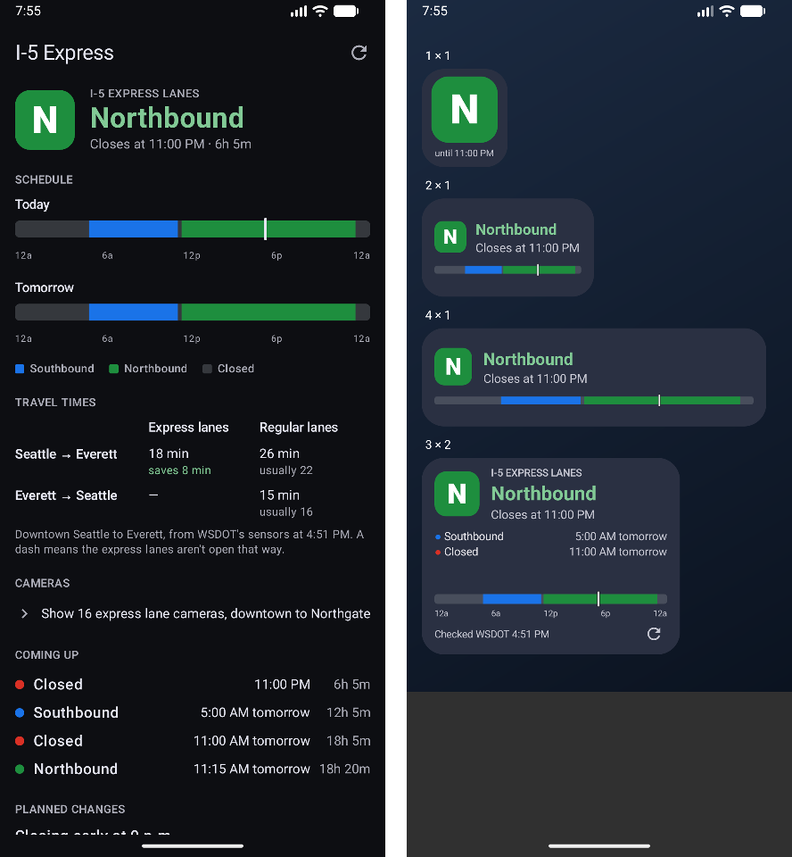

# I-5 Express for Android

[](https://github.com/andrewmacheret/i5-android/actions/workflows/build.yml)

A home screen widget that shows which way Seattle's I-5 express lanes are running right now, and whether they're open at all. Tap it for the details.


It's the Android version of [i5-macos-menubar](https://github.com/andrewmacheret/i5-macos-menubar), and uses the same rules.

## Features

### Widget

- A colored badge shows the current state: green **N** for northbound, blue **S** for southbound, red **✕** for closed.
- Under it: when the lanes change next, the next couple of changes after that, and a timeline of today with a marker for now.
- An amber **⚠ Can't confirm** replaces the badge whenever the app can't vouch for the status, with the reason. It still shows the posted schedule, labeled "not confirmed". See [When to trust it](#when-to-trust-it).
- A gray **? Checking…** shows briefly while the app re-reads WSDOT's page.
- The refresh button in the corner re-reads WSDOT's page. Tapping anywhere else opens the app.
- The widget updates itself at the exact minute the lanes change, at midnight, and when its data gets too old to trust. It doesn't wait for the next scheduled check.


Other reasons it won't confirm include a WSDOT notice about today and a saved copy of the page that's more than 2 hours old:


### Widget sizes

The widget is resizable. Smaller sizes drop detail but keep the badge and the next change:

- **1 × 1:** the badge and "until 9:00 PM".
- **2 × 1 and wider:** the badge, direction, next change and today's timeline.
- **3 × 2 and bigger (the default):** everything above, plus the next changes, hour labels, when WSDOT was last read, and the refresh button.

Text is never cut off. It's measured at your phone's font size, and when it doesn't fit the widget uses shorter wording: "Closes at 11:00 PM", then "until 11:00 PM", then "11:00 PM", and "North" for "Northbound". A time never splits across two lines. On a very narrow 1 × 1 the widget leaves the time off rather than cut it.


### Dark mode

The app and widget follow the phone's light or dark mode. On Android 12 and later the app also picks up your wallpaper colors.



### App

Tap the widget, or open **I-5 Express** from the app drawer:

- **Status:** the current direction and what happens next, like "Closes at 9:00 PM · in 4h 5m".
- **Warnings:** each reason the status can't be confirmed, with links to live sources (traffic cameras, [@wsdot_traffic](https://x.com/wsdot_traffic) and WSDOT's page) so you can check before you drive.
- **Notices:** closures in effect now, tonight's early closure, and WSDOT notices. Old notices that WSDOT hasn't taken down yet are grayed out.
- **Schedule:** colored timelines for today and tomorrow, with a marker for now.
- **Coming up:** the next four changes with countdowns. A ⚠ marks days that may not follow the regular schedule.
- **Planned changes:** weekend closures, early closing dates, and holidays in the next two weeks.
- **Regular schedule and sources:** the weekly schedule as WSDOT posts it, and links to every page the data comes from.
- Pull down, or tap the refresh button, to re-read WSDOT's page. Everything the app shows comes from that one page, about 40 KB, so a refresh usually takes well under a second. It also refreshes when you open the app, within the limits in [Settings](#settings).

Times are always Seattle time. If your phone is set to another time zone, the app and widget say so.

<p>
  
</p>
<p>
  
</p>

### Notifications

Turn on **Notify when lanes change** in the app's settings to get:

- an alert when the lanes switch direction, open or close;
- an alert when the app goes from confirmed to "can't confirm", with the reason.

To keep alerts useful, the app:

- skips the 15-minute weekday switchover gap;
- skips any change it missed while the phone was off or asleep for a long time;
- doesn't alert when the only problem is old data, since that usually fixes itself on the next refresh (for example right after the phone starts up, or overnight when Android pauses the network);
- holds a "can't confirm" alert until the lanes are scheduled to open, so a holiday doesn't buzz you at midnight.

It asks for notification permission when you turn this on, and shows a link to Android's settings if notifications are blocked.


### Settings

- **Notify when lanes change**, described above.
- **Check WSDOT on Wi-Fi every** 15 minutes (the default), 30 minutes or 1 hour.
- **Check WSDOT on mobile data every** 15 minutes, 30 minutes, 1 hour (the default), or **Off**. Each check uses about 45 KB, so 1 hour is at most about 32 MB a month and 15 minutes about 130 MB. On mobile data, opening the app also waits for this setting. With **Off**, the app only uses mobile data when you tap refresh or add a widget. Away from Wi-Fi, the widget then shows ⚠ once the data is 2 hours old, and the app checks again when you're back on Wi-Fi.
- Wi-Fi here means any network Android doesn't treat as metered. A phone hotspot counts as mobile data. Tapping refresh always checks, on any network.
- **Home screen widget:** an **Add** button that puts the widget on your home screen, on launchers that support it.
- If exact alarms are off, a note explains that the widget may update up to 10 minutes late, with an **Allow** button. They start off on Android 14 and later. See [Battery and alarms](#battery-and-alarms).
- At the bottom: a link to the [privacy policy](PRIVACY.md).

## When to trust it

WSDOT doesn't publish a live feed for the express lanes. This app reads [WSDOT's express lanes page](https://wsdot.wa.gov/travel/roads-bridges/express-lanes) and works out the status from the posted schedule, early closures and planned closures.

It only shows **N**, **S** or **✕** when all of these are true:

- It read WSDOT's page in the last 2 hours. It checks on a schedule you pick in [Settings](#settings), when you open the app, and after the phone restarts.
- Every part of the page made sense. A new section or a line it can't read counts as a problem.
- The schedule itself looks sane, with no overlapping or backwards time ranges.
- Nothing on the page suggests today is different. That includes notices dated today, undated notices, and planned closures today without exact times.
- If today closes early, the page gives the closing time.
- Today isn't a holiday. WSDOT doesn't post holiday hours.

Otherwise it shows an amber **⚠**, explains why, and links to the [travel map](https://wsdot.com/travel/real-time/map/) and [@wsdot_traffic](https://x.com/wsdot_traffic) so you can check a live source.

If WSDOT can't be reached, the app keeps using the last good copy of the page, and shows ⚠ once that copy is more than 2 hours old. The widget switches to ⚠ at that moment even if the phone is offline.

If WSDOT's page changes into something the app can't read, it shows ⚠ until it reads a good copy again. It remembers this across restarts and failed downloads, so it never quietly goes back to trusting the old copy.

Notices count from their first date until their last. A notice like "As of Nov. 16, the express lanes are closed" has no end date, so it counts for as long as it's on the page.

It can't know about a closure WSDOT hasn't posted yet, like an emergency repair announced only on social media.

## Install

There's no Play Store listing. Download the APK from [Releases](https://github.com/andrewmacheret/i5-android/releases), or build it yourself. The app needs Android 8.0 or later.

### Download the APK

**On the phone:** open the [latest release](https://github.com/andrewmacheret/i5-android/releases/latest) in the phone's browser and tap the `.apk` file. Android asks you to allow installs from your browser the first time. Then tap **Install**.

**From a computer with `adb`:** download the `.apk` from the latest release, get your phone ready (step 1 below), then run:

```bash
adb install -r i5-express-v1.0.0.apk
```

Use the file name of the version you downloaded. Then [add the widget](#3-add-the-widget).

### Build it yourself

You need [Android Studio](https://developer.android.com/studio), which brings the SDK, a JDK and `adb`. Building works on macOS, Linux and Windows. The `make` commands need macOS or Linux. On Windows, use the Gradle steps under [Build and install](#2-build-and-install).

Android Studio puts these in different places on each system:

| | SDK, with `adb` in its `platform-tools` folder | Bundled JDK |
| --- | --- | --- |
| macOS | `~/Library/Android/sdk` | `/Applications/Android Studio.app/Contents/jbr/Contents/Home` |
| Linux | `~/Android/Sdk` | the `jbr` folder where you unpacked Android Studio |
| Windows | `%LOCALAPPDATA%\Android\Sdk` | `C:\Program Files\Android\Android Studio\jbr` |

The commands below say `adb`. Add the SDK's `platform-tools` folder to your PATH, or type the full path.

### 1. Get your phone ready

1. Turn on developer options: open **Settings > About phone** and tap **Build number** seven times.
2. Turn on **Settings > System > Developer options > USB debugging**.
3. Plug the phone into your computer and tap **Allow** on the "Allow USB debugging?" prompt.

Check that `adb` sees it:

```bash
adb devices
```

Your phone should be listed as `device`. If it says `unauthorized`, unlock the phone and accept the prompt.

### 2. Build and install

```bash
git clone https://github.com/andrewmacheret/i5-android.git
cd i5-android
make release
```

That builds the release APK and installs it with `adb`. It finds the SDK and JDK in the places above. If yours are elsewhere, set `ANDROID_HOME` and `JAVA_HOME`. If more than one device is connected, such as a phone and an emulator, name the one you want with the serial from `adb devices`:

```bash
ANDROID_SERIAL=<serial> make release
```

To run the steps yourself instead of using `make`, which you need to do on Windows:

```bash
./gradlew :app:assembleRelease      # on Windows: gradlew.bat :app:assembleRelease
adb -s <serial> install -r app/build/outputs/apk/release/app-release.apk
```

Gradle has to find the SDK and a JDK. If you've opened the project in Android Studio, it already set that up. Otherwise set `ANDROID_HOME` to the SDK folder and `JAVA_HOME` to the bundled JDK from the table above.

`-r` keeps the app's data and widgets when you install over an older copy. If Google Play Protect warns about an unknown app, choose to install anyway. It hasn't seen this app before because you built it.

### 3. Add the widget

Long press your home screen, tap **Widgets**, and drag **I-5 Express** onto it. Or open the app and tap **Add** in settings. Turn on **Notify when lanes change** in the app if you want alerts.

To remove the app, uninstall it like any other app, or run `adb uninstall com.andrewmacheret.i5`.

Android only installs an update over an existing copy if both are signed with the same key. The APKs on the Releases page share one key. A copy you build yourself is signed with your own debug key, so to switch between the two you have to uninstall first, which clears the app's settings.

### Battery and alarms

The app doesn't run in the background. Android wakes it:

- every 15 minutes to 1 hour, depending on your settings and whether you're on Wi-Fi, to re-read WSDOT's page;
- with an exact alarm at the next lane change, at midnight, and when the data would go stale, to redraw the widget. The alarm draws the widget itself instead of waiting for a background job, so the widget flips on time even while the phone is idle.

That's a handful of short wake-ups a day.

Exact alarms need the **Alarms & reminders** permission. On Android 14 and later it starts off, and you turn it on with **Allow** in the app's settings. Without it the widget still updates, up to 10 minutes after each change while the phone is awake, or when you next wake the phone. The app asks for this permission instead of the automatic one because Google Play only allows that for alarm clock and calendar apps.

## Development

The Makefile works on macOS and Linux. It uses Android Studio's bundled JDK and SDK from [the places above](#build-it-yourself), so you don't need a separate Java install. Set `JAVA_HOME`, `ANDROID_HOME` or `AVD` if yours are elsewhere. On Windows, run the Gradle tasks from the Makefile with `gradlew.bat`.

| Command | What it does |
| --- | --- |
| `make test` | Run the parser, schedule, trust and alert tests |
| `make build` | Build the debug APK |
| `make install` | Build and install the debug APK |
| `make run` | Install the debug APK and open the app |
| `make release` | Build the shrunk release APK and install it, signed with the release key if it's in this Mac's Keychain, or else the debug key |
| `make bundle` | Build the signed app bundle (`.aab`) that Google Play wants |
| `make emulator` | Start the emulator named by `AVD` |
| `make lint` | Run Android lint |
| `make scenario NAME=holiday` | Show a made-up moment, debug builds only (see below) |
| `make gallery` | Open the widget size gallery, debug builds only. `make gallery MORE=1` adds narrow and in-between sizes, for checking that no text gets cut off |
| `make screenshots` | Regenerate the images in `docs/` |

The code is split into two modules:

- `core` is plain Kotlin with no Android code. It reads WSDOT's page (`Parser`), works out the status at any moment (`Engine`), decides whether the status can be trusted (`Trust`), and decides when to alert (`Alerts`). Tests run against a saved copy of WSDOT's page in `core/src/test/resources`.
- `app` is the Android app: the widget (Jetpack Glance), the app screen (Jetpack Compose), background refresh (WorkManager), exact alarms, and notifications.

### Debug scenarios

Debug builds can show a made-up moment instead of the live status, using a saved copy of WSDOT's page. That's how the screenshots are made, and how you can check every state without waiting for it:

```bash
make scenario NAME=north     # also: evening south closed weekend closure notice holiday stale checking offline broken
make scenario NAME=live      # back to the real status
```

Debug builds also have test hooks for notifications and for the alarm that fires at each lane change:

```bash
adb shell am broadcast -n com.andrewmacheret.i5/.DebugReceiver --es notify change   # or closed, cantconfirm
adb shell am broadcast -n com.andrewmacheret.i5/.DebugReceiver --ez tick true
```

None of this is in release builds.

### Releases

GitHub Actions ([`build.yml`](.github/workflows/build.yml)) runs the tests and a debug build on every push. Pushing a version tag also builds the signed release APK and publishes it on the [Releases](https://github.com/andrewmacheret/i5-android/releases) page. It also saves the signed app bundle for Google Play as a download on that run (**Artifacts**, kept 90 days):

```bash
git tag v1.0.1
git push origin v1.0.1
```

The tag sets the version name. The version code is the number of commits, so every release installs over the last one.

The release key is managed by [`scripts/signing.sh`](scripts/signing.sh). It keeps the key in the macOS Keychain, so it only works on a Mac. You don't need it to build. Without it, builds use the debug key.

| Command | What it does |
| --- | --- |
| `scripts/signing.sh create` | Make the key, once ever, and back up the key file and its password in the macOS Keychain |
| `scripts/signing.sh github` | Copy both into the repo's GitHub Actions secrets, `I5_KEYSTORE_BASE64` and `I5_KEYSTORE_PASSWORD` |
| `scripts/signing.sh restore` | Write the key file back out from the Keychain, to `~/.android/i5-android-release.jks` |
| `scripts/signing.sh run <command>` | Run a build with the key, which is what `make release` does |

The Keychain holds the only copy you can read back, since GitHub secrets are write-only. Don't delete the `i5-android-release-keystore` and `i5-android-release-password` items. Without them, the next release can't update phones that already have the app. The password only travels through environment variables and stdin, never on a command line.

### Google Play

The app isn't on Google Play yet, but it's ready to upload. When you set up Play App Signing, choose to use your existing key and upload this one, rather than letting Google make a new key. Then copies from Google Play and from the Releases page share a signature, and each can update the other. The privacy policy URL for the listing is <https://github.com/andrewmacheret/i5-android/blob/main/PRIVACY.md>.

## Privacy

The app collects nothing. It only talks to WSDOT, and everything it saves stays on your phone. See the [privacy policy](PRIVACY.md).

## Built with LLM tools

This project was written with LLM coding tools: an AI agent in [Cursor](https://cursor.com) wrote the code, tests and this README, directed by a human. Treat it like any other code from the internet and read it before you rely on it.

## Not affiliated with WSDOT

This is a personal project. Schedule data comes from the Washington State Department of Transportation. Always follow posted signs on the road.

## License

[MIT](LICENSE)
